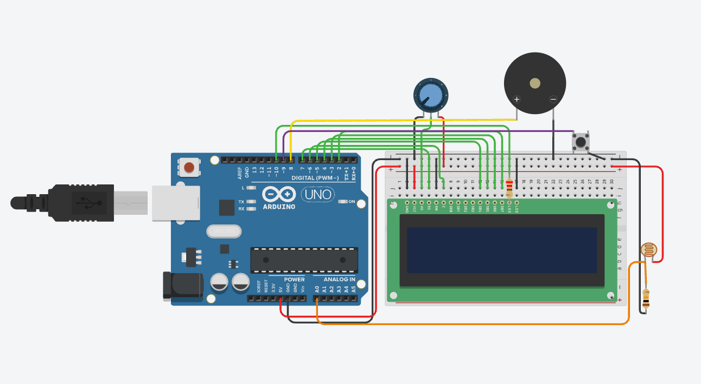

# Digital Clock with Alarm & Auto-Brightness (Arduino UNO)

A microcontroller-based digital clock built on Arduino UNO (ATmega328P) featuring an alarm system and automatic LCD backlight adjustment based on ambient light.

🔗 **Live Simulation:** [Run in Tinkercad](https://www.tinkercad.com/things/di8oHcCr8LE-projekt?sharecode=tsM7_Q8fyuQ4TSYR1TzrmnWkhlty0f6lyOo6LEKYSh4)

## Features
* **Non-blocking Timekeeping:** Uses `millis()` instead of `delay()` to maintain accurate time without blocking main loop execution.
* **Adaptive Backlight Control:** Reads ambient light levels via a photoresistor (LDR) voltage divider (`A0`) and dynamically adjusts LCD backlight brightness using PWM (`D10`).
* **Alarm System:** Triggers an acoustic signal via an active buzzer (`D8`) when the set alarm time is reached, silenced via a push-button configured with `INPUT_PULLUP` (`D9`).
* **4-bit LCD Interface:** Displays real-time clock (`HH:MM:SS`) and alarm status on a 16x2 alphanumeric LCD.

## Hardware & Wiring

* **Microcontroller:** Arduino UNO (ATmega328P)
* **Display:** LCD 16x2 (4-bit mode: RS -> D7, E -> D6, D4-D7 -> D5-D2)
* **Sensors & Actuators:** Photoresistor (LDR) + 10kΩ resistor, Active Buzzer, Monostable Pushbutton, 10kΩ Potentiometer (contrast control)

## Documentation
Full technical documentation (hardware description, pinout specification, and program algorithm) is available in [Dokumentacja Projektowa.pdf](docs/Dokumentacja%20Projektowa.pdf).
